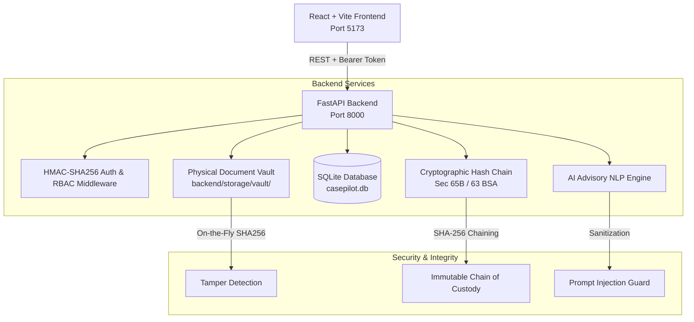

# ⚖️ CasePilot AI — Legal Tech Platform (PS-01)

> **Enterprise Legal Intelligence, Matter Lifecycle & Chamber Management with Human-in-the-Loop AI Advisory Review.**

[](https://fastapi.tiangolo.com)
[](https://vitejs.dev)
[](https://indiacode.nic.in)
[](https://owasp.org)

---

## ⚡ Quick Start in 60 Seconds

The application is pre-configured and runs completely locally out-of-the-box.

### 1. Start Backend API Server
```bash
cd backend
# Windows:
.venv\Scripts\activate
uvicorn app.main:app --reload --host 127.0.0.1 --port 8000

# macOS / Linux:
source .venv/bin/activate
uvicorn app.main:app --reload --host 127.0.0.1 --port 8000
```
- **API Base:** `http://127.0.0.1:8000`
- **Interactive OpenAPI (Swagger) Docs:** `http://127.0.0.1:8000/docs`

### 2. Start Frontend UI
```bash
cd frontend
npm install
npm run dev -- --host 127.0.0.1
```
- **Web Application:** `http://127.0.0.1:5173`

---

## 👥 Demo Personas & Pre-Configured Credentials

CasePilot AI features server-enforced **Role-Based Access Control (RBAC)**. You can easily switch personas using the top-bar dropdown in the UI or login with the credentials below:

| Persona | Role | Email | Password | Permissions & Role Boundaries |
| :--- | :--- | :--- | :--- | :--- |
| **Arjun Kapoor** | `Managing Attorney` | `arjun.kapoor@lexford.legal` | `attorney123` | **Full Chamber Control:** Can create/delete cases, schedule hearings, sign off on AI reviews, and verify audit chains. |
| **Priya Nair** | `Senior Associate` | `priya.nair@lexford.legal` | `associate123` | **Senior Counsel:** Can manage cases, verify candidate facts, and sign off on advisory summaries. Restricted from matter deletion. |
| **Rohan Gupta** | `Paralegal` | `rohan.gupta@lexford.legal` | `paralegal123` | **Research & Drafting:** Can upload evidence and draft tasks. **Server blocked** from deleting records or signing off on legal reviews. |
| **Kavita Desai** | `Compliance Officer` | `kavita.desai@lexford.legal` | `compliance123` | **Auditor:** Inspects Section 65B/63 cryptographic hash chains, exports archives, and verifies chain-of-custody. |

---

## 🗺️ Interactive Feature Tour

### 1. Executive Counsel Dashboard
- Live metrics showing **Active Matters**, **Upcoming Hearings**, **Pending Tasks**, and **AI Reviews Awaiting Sign-Off**.
- High-priority hearings cause list with courtroom numbers, judge benches, and countdown badges.
- One-click quick actions to create matters, schedule hearings, or review candidate facts.

### 2. Matter Lifecycle & Case Dossier (FR-003, FR-004)
- Filter by status: `Active`, `In Review`, `Hearing Scheduled`, `On Hold`, `Closed`, `Archived`.
- Full case dossier drawer including parties, claims, assigned lead counsel, filing date, and court jurisdiction.
- **1-Click CSV Export:** Generate a ready-to-print cause roster for courtroom filing directly from the Cases view.

### 3. Evidentiary Document Vault (FR-005)
- Categorized storage for Pleadings, Affidavits, Contracts, Notices, and Certified Orders.
- **Physical Vault Storage:** Files stored securely on disk at `backend/storage/vault/`.
- **SHA-256 Checksum Fingerprint:** Each file is hashed upon upload. Downloads verify the hash on-the-fly to prevent and detect file tampering under the **Bharatiya Sakshya Adhiniyam (BSA), 2023**.

### 4. Human-in-the-Loop AI Review Desk (FR-006, FR-007)
> **Statutory Advisory Safeguard:** In strict compliance with Bar Council of India (BCI) ethical standards and FR-007, AI outputs are never authoritative until verified by counsel.
- **Dynamic Fact Extraction:** AI extracts candidate dates, breach milestones, and statutory provisions (e.g., *Section 73 Contract Act*, *Order 39 CPC*, *Section 138 NI Act*).
- **Interactive Verification:** Counsel can click **Accept** (green) or **Reject** (red) on individual facts, or edit fact text.
- **Mandatory Lawyer Attestation:** Counsel must affirmatively check the statutory advisory acknowledgment before submitting their digital signature (`SIGNED://Arjun Kapoor/BAR-CHAMBER-2026`).

### 5. Tamper-Evident Cryptographic Audit Chain (FR-010)
- Meets **Section 65B Indian Evidence Act** and **Section 63 Bharatiya Sakshya Adhiniyam (BSA)** evidentiary standards.
- Every workspace event (login, case edit, document upload, fact verification) is cryptographically chained:
  $$\text{Record Hash} = \text{SHA256}(\text{Prev Hash} \parallel \text{Timestamp} \parallel \text{Action} \parallel \text{Actor} \parallel \text{Details})$$
- Click **"Verify Hash Chain Proof"** in the Audit Logs view to run a real-time sequential verification from genesis root to the latest block.

### 6. Import, Export & Integration APIs (FR-011)
- **JSON Workspace Snapshot:** Full portable backup of all cases, documents, hearings, tasks, and audit logs.
- **CSV Case Roster:** Spreadsheet-compatible docket export for Excel / court clerks.
- **Batch Case Importer:** Paste structured JSON arrays to ingest multiple cases with schema validation.
- **OpenAPI 3.0 Documentation:** Fully interactive API explorer at `http://127.0.0.1:8000/docs`.

---

## 🏛️ System Architecture



---

## 🧪 Testing Role-Based Security in the UI

You can verify the security boundaries in under 30 seconds:
1. Open the app at `http://127.0.0.1:5173`.
2. Notice you start as **Arjun Kapoor (Managing Attorney)**.
3. Open any case (e.g. *Sharma vs. Eastern Industries*). The **Delete Case** button is enabled.
4. Switch the persona dropdown in the top bar to **Rohan Gupta (Paralegal)**.
5. Notice that:
   - The UI warns that paralegals have restricted administrative access.
   - Deleting a case or signing off on an AI review returns an enforced `HTTP 403 Forbidden` response from the backend.

---

## 📂 Pre-Seeded Sample Cases

The platform comes pre-populated with realistic legal matters:
- **`CP-2026-024` — Sharma vs. Eastern Industries:** Commercial breach of equipment supply agreement under Section 73 Indian Contract Act.
- **`CP-2026-018` — Mehta Property Dispute:** Partition suit and urgent Order 39 Rules 1 & 2 CPC ad-interim injunction application.
- **`CP-2026-031` — Verma SaaS Contract Review:** Cross-border master services agreement with limitation of liability and SIAC arbitration clause.
- **`CP-2026-012` — Rao Employment Matter:** Labor tribunal dispute regarding non-compete covenants under Section 27 Contract Act.
- **`CP-2026-045` — Apex Pharma Patent Infringement:** High Court Commercial Division patent suit under Section 108 Patents Act.

---

## 🔧 Useful API Commands (cURL)

#### 1. Obtain Bearer Token
```bash
curl -X POST http://127.0.0.1:8000/api/v1/auth/switch-demo \
     -H "Content-Type: application/json" \
     -d "{\"role\": \"Managing Attorney\"}"
```

#### 2. Verify Cryptographic Audit Chain Integrity
```bash
curl -X GET http://127.0.0.1:8000/api/v1/audit-logs/verify-integrity \
     -H "Authorization: Bearer <TOKEN>"
```

#### 3. Export Workspace JSON
```bash
curl -X GET http://127.0.0.1:8000/api/v1/export/json \
     -H "Authorization: Bearer <TOKEN>" -o workspace_backup.json
```

---

## 📜 Compliance & Ethical Standards
CasePilot AI is engineered to adhere to the highest standard of legal professional ethics:
- **Bar Council of India (BCI) Rules on Professional Conduct:** AI does not furnish independent legal advice or replace attorney judgment.
- **Section 65B Indian Evidence Act / Section 63 Bharatiya Sakshya Adhiniyam, 2023:** Cryptographic audit trail and document hashing ensure tamper-evident admissibility in judicial proceedings.
- **Digital Personal Data Protection (DPDP) Act, 2023:** Full data portability via one-click structured JSON and CSV exports.
